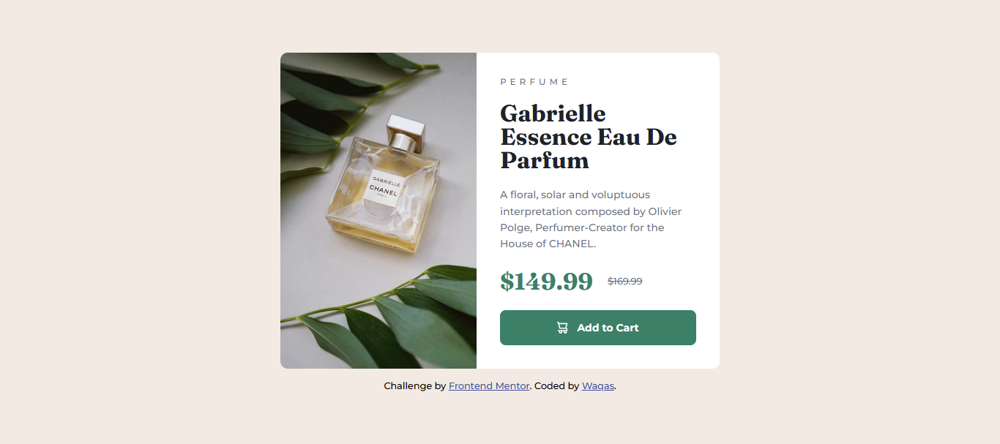

# Frontend Mentor - Product preview card component solution

This is a solution to the [Product preview card component challenge on Frontend Mentor](https://www.frontendmentor.io/challenges/product-preview-card-component-GO7UmttRfa). Frontend Mentor challenges help you improve your coding skills by building realistic projects. 

## Table of contents

- [Overview](#overview)
  - [The challenge](#the-challenge)
  - [Screenshot](#screenshot)
  - [Links](#links)
- [My process](#my-process)
  - [Built with](#built-with)
  - [What I learned](#what-i-learned)
- [Author](#author)

## Overview

### The challenge

Users should be able to:

- View the optimal layout depending on their device's screen size
- See hover and focus states for interactive elements

### Screenshot



### Links

- Solution URL: [GitHub Repository](https://github.com/battleshopventureswaqas-blip/product-preview-card-component)
- Live Site URL: [Live Demo on GitHub Pages](https://battleshopventureswaqas-blip.github.io/product-preview-card-component/)

## My process

### Built with

- Semantic HTML5 markup (`<main>`, `<picture>`, `<s>`, `<footer>`)
- CSS custom properties (variables)
- Flexbox layout
- Responsive web design with `@media` queries
- Google Fonts (`Montserrat` and `Fraunces`)

### What I learned

Working through this challenge helped me solidify several core HTML and CSS concepts:

1. **Responsive Art Direction with `<picture>`:** Instead of loading both mobile and desktop images or using CSS `background-image` hacks, I learned how to use the HTML `<picture>` element with a `<source media="(min-width: 600px)">` tag so the browser automatically switches images based on screen width:

```html
<picture class="card-img">
  <source media="(min-width: 600px)" srcset="./images/image-product-desktop.jpg">
  
</picture>
```
## Author

- Frontend Mentor - [](https://www.frontendmentor.io/profile/yourusername)
- Linkedin - [Waqas](https://www.linkedin.com/in/muhammad-waqas-siddique-9538213b7/)


